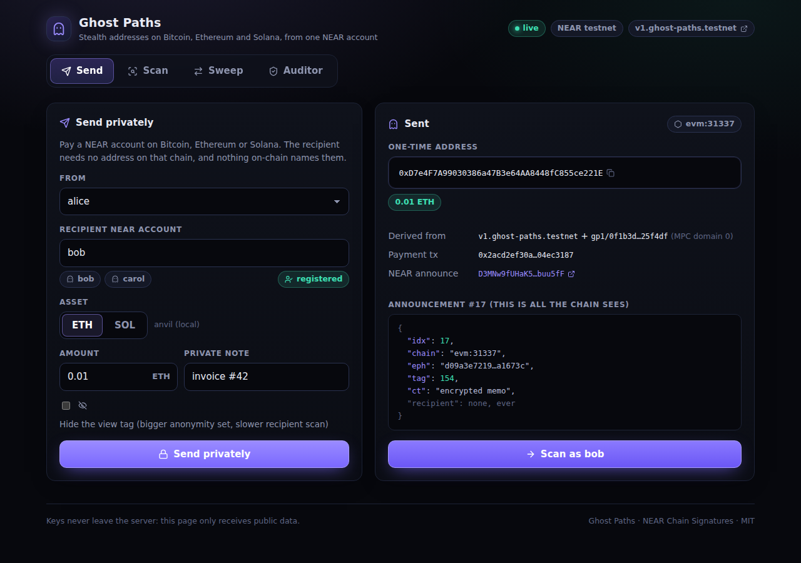
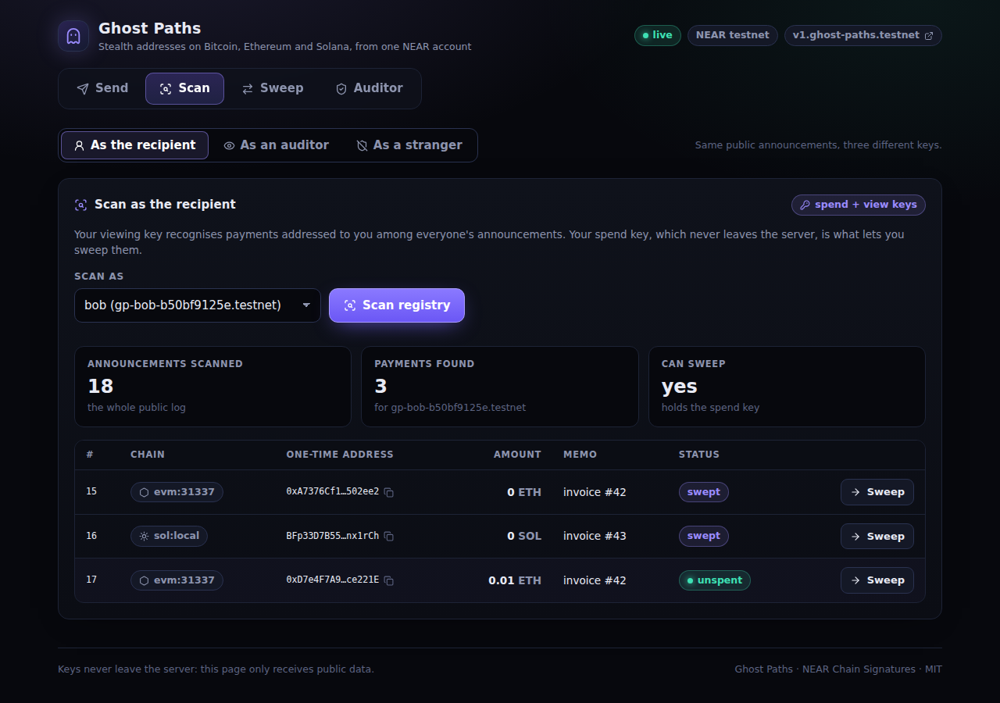

# Ghost Paths: stealth addresses on Bitcoin, Ethereum and Solana from one NEAR account

Built at **NEAR HACKATHON** (November 2026) by **Aarone George** (solo). Tracks: `privacy`, `realworld`, `open`. License: MIT.

Ghost Paths lets anyone pay a NEAR account privately on Ethereum/Base or Solana (Bitcoin addresses are derived, not yet paid; see
[Limitations](#limitations-and-next-steps)) at a fresh one-time address that the recipient never generated and that nothing on-chain links to them (amounts and timing stay public; see Limitations).
It is [ERC-5564](https://eips.ethereum.org/EIPS/eip-5564) stealth addresses rebuilt on **NEAR Chain Signatures**. The recipient registers one
meta-address (a spend public key and an X25519 viewing key) in a small NEAR contract. A payer derives a one-time address from it, pays that address on the target chain,
and posts an announcement with no recipient field to NEAR. The recipient, or an auditor holding only the viewing key, scans the announcements.
Only the recipient can sweep, by authorising the Ghost Paths contract to request an MPC signature from `v1.signer`. The recipient never holds a
Bitcoin, Ethereum or Solana key: the MPC network signs for every chain from the same two root keys.

The use case aimed at a normal company is **private payroll**: an employer pays contractors in ETH at stealth addresses and the accountant gets a viewing key.




Related project by the same submitter: see [Related project](#related-project-by-the-same-submitter) (Tripwire).

---

## Try it (do X, see Y)

**Requirements.** Everything below is tested with `bun 1.4.3` on Linux. Only `git` and `bun` are required for the fast path.

| Tool | Needed for | Required? |
|---|---|---|
| `git`, [`bun`](https://bun.sh) 1.4.3 | everything | yes |
| `make` | the targets below | yes |
| `docker` | `make demo` (anvil + a local Solana validator). Without docker, `make demo` runs the offline replay and says so. First run pulls about 1 GB of images | optional |
| Rust, `cargo-near`, the `wasm32-unknown-unknown` target | Rust contract tests, rebuilding the wasm | optional |
| Network access to NEAR testnet | `make demo`, `make test-live` | optional (not needed for `make demo-replay`) |

If a step fails because the NEAR testnet or its MPC network is down, use `make demo-replay`: it needs nothing.

### Fast path (about 2 minutes, no docker, no network, no keys)

1. Clone and install.
   ```bash
   git clone https://github.com/AaroneGeorge/near-ghost-paths && cd near-ghost-paths
   bun install
   ```
   See: `bun install` finishes with a line like `NNN packages installed`.

2. Run the complete demo offline.
   ```bash
   make demo-replay
   ```
   See: ends with `demo OK: 17/17 checks passed in ~33 s (replayed, offline)`. In between you see the eight steps of the demo script:
   Bob registers one meta-address; Alice pays 0.01 ETH on `evm:31337` and 0.1 SOL on `sol:local` at one-time addresses
   (`derived from v1.ghost-paths.testnet + gp1/...`); a stranger (`carol`) scans and finds **0 payments**; Bob finds **2**, with decrypted memos; an auditor with only a
   viewing key sees the same 2 and prints `viewing key only: no spend key, cannot sweep`; Bob sweeps both through the relayer and the MPC
   (`NEAR explorer: v1.ghost-paths.testnet requested a signature for path gp1/...; nothing names <bob>`); and a 1Click dry quote is printed.
   This runs the real CLI, SDK and relayer code against recorded responses of a real run (2026-11-08) of the real testnet MPC; the explorer
   links in the output are real transactions from that recording. To prove it is offline: `make demo-replay-airgap` (needs `unshare`; may use `sudo`).

3. Run the tests (TypeScript, offline, no Rust needed).
   ```bash
   make test-ts
   ```
   See: `82 pass`, `5 skip`, `0 fail` (the skips are the live tests, which need `LIVE=1`). That includes `packages/sdk/test/fixtures.test.ts`: recorded real MPC
   signatures are checked offline, so you see that the **derived address equals the key the MPC signed for**, for secp256k1 (the ECDSA signature recovers to
   `derive(v1.ghost-paths.testnet, path)`) and for ed25519 (the signature verifies under it). `make test` adds the Rust contract tests (unit and a NEAR sandbox)
   when `cargo` and `cargo-near` are installed; otherwise it prints `SKIPPING the Rust contract tests` and still passes.

4. See the derivation without any network (this is the formula the whole project rests on).
   ```bash
   bun packages/cli/src/ghost.ts derive --chain evm:1 --predecessor v1.ghost-paths.testnet --path gp1/$(printf 'ab%.0s' $(seq 32))
   ```
   See: `address 0x5c7dad9d2e0B89E71F3ceB876c270AB1013CcAb9`. Change `--chain` to `sol:devnet` (see `8f6Pmk8tuN6sFbMXoSF1FFz2wGmZkk1q72PMdw7zpUvm`) or
   `btc:testnet4` (see `tb1qshvntagprslsmtj9306x4nlwgkwq54fl8xucmu`). These three values were read from `v1.signer-prod.testnet`'s `derived_public_key` view and are asserted in the tests.

5. Look at the web UI with no network and no docker (simulated chains, real stealth cryptography).
   ```bash
   make web-sim
   ```
   See: `ghost serve (dev: simulated chains, no network) on http://127.0.0.1:8788` and an `open http://127.0.0.1:8788/?token=…` line. Open that URL (the token authorises pay, sweep and scan for this session): tabs **Send**, **Scan**, **Sweep**, **Auditor**, and a banner saying the chains are simulated.
   Send 0.01 ETH to `bob`; Scan as the recipient shows 1 payment; "As a stranger" shows 0; Sweep moves the balance. Stop with Ctrl-C.
   (`make web-e2e` drives exactly this with Playwright; it needs a Chromium that Playwright can find.)

### Real run: NEAR testnet MPC plus local chains (about 90 seconds, plus docker start)

6. With docker running:
   ```bash
   make demo
   ```
   See: `demo OK: 17/17 checks passed in ~85 to 90 s`. Same eight steps, but live: three fresh NEAR testnet accounts, the contract `v1.ghost-paths.testnet`, real signatures from `v1.signer-prod.testnet`
   (`MPC signature in` about 6 to 8 s), anvil (`evm:31337`) and a local Solana validator (`sol:local`) in docker, real `https://testnet.nearblocks.io/txns/...` links.
   The first run on a machine creates one funder account with the NEAR testnet faucet helper and caches it in `.secrets/demo/funder.json`; each run spends about 0.03 NEAR and deletes its accounts at the end.
   If the helper answers `429` (it rate-limits per IP; the error says `retry in N hours`), pass a funder you already have: `DEMO_FUNDER_FILE=/path/funder.json make demo`, where the file is JSON like `{"account_id": "you.testnet", "secret_key": "ed25519:..."}` for any testnet account with at least 3 NEAR (the same variable is needed for `make test-live` and `make demo-clean`). Or use `make demo-replay`. (The CLI also accepts `GHOST_FUNDER_FILE` as the same thing.)

7. Same run, then the web UI against its state.
   ```bash
   KEEP=1 make demo      # leaves the chains and the relayer running
   make web              # builds the UI and serves http://127.0.0.1:8788 against that state (open the printed /?token=… URL)
   make demo-clean       # afterwards: stops everything, deletes the kept accounts
   ```
   See: a green `live` badge, `NEAR testnet`, `v1.ghost-paths.testnet`. Scan as `bob` lists the demo's two swept payments; Send 0.01 ETH `alice` to `bob`, then Scan, then Sweep: the destination balance moves.
   (Port 8788 serves the UI. `make web-dev` starts Vite's hot-reload server on 5173, which proxies `/api` to 8788; open it with the same `?token=…`.)

8. One real MPC signature per curve, checked against the derived key (needs network, about 20 to 30 s).
   ```bash
   make test-live
   ```
   See: `ECDSA ok in 6 to 8 s, tx <hash>` with `recovered key == derive(v1.ghost-paths.testnet, gp1/...) == signer view`, then `EdDSA ok in 6 to 8 s`, and `3 pass` (about 15 to 20 s in total). It submits two `sweep` calls to
   `v1.ghost-paths.testnet` with a fresh random stealth key (no funds involved) and checks the signature against both the local derivation and the signer's own `derived_public_key` view.
   It uses the same cached funder account as step 6 (or creates one from the faucet; on a `429` set `DEMO_FUNDER_FILE` as in step 6).

### Optional

9. `make demo-testnet`: the same flow on Sepolia and Solana devnet. Needs a payer: `FUNDER_EVM_PK` and `FUNDER_SOL_KEY` (see `.env.example`). It moves about 0.001 ETH and 0.02 SOL and sweeps them to the payer's own addresses.
   Ran green during development (17/17, about 110 s) on the author's machine; it is not part of the fast path because it needs funded test keys.
10. `make demo-live`: designed for NEAR mainnet + Base + a 1Click confidential sweep. It **refuses** without `MAINNET_APPROVED=1`, a mainnet contract and mainnet profiles, prints what is missing, runs only a free keyless 1Click **dry** quote
    and exits 0 having spent nothing. No mainnet contract exists yet (see [Limitations](#limitations-and-next-steps)).

11. `make video`: renders the demo video, `docs/video/ghost-paths-demo.mp4` (1:52, silent, burned-in captions, poster next to it), from a real `KEEP=1 make demo` run and the real web UI driven by Playwright; it cleans up afterwards. It shows the testnet MPC with local chains, the web send/scan/sweep flow, and a limits card. It does **not** show a Bitcoin payment (derive-only) or the confidential 1Click sweep (needs an API key, not run). `VIDEO_SOURCE=replay make video` renders offline and labels itself replayed/simulated.

---

## What it does and how it works

```
  payer (CLI / web)                          recipient / auditor (CLI / web)
  registry.get_meta(bob) ─┐                  ┌─ registry.get_announcements(cursor)
  derive A (chainsig.js)  │   NEAR testnet   │  x25519 scan, derive A, balances
  pay A on the target ────┼──► v1.ghost-paths ◄── sweep: sign msg with d_K ──► relayer ──► ghost.sweep(...)
  announce(E, tag, ct) ───┘    registry +                                          │ env::ecrecover == K
                               announcement log +                                  ▼
                               sweep gateway          v1.signer-prod.testnet (MPC, domains 0 and 1) ──► signature
```

1. **Register.** Bob derives `d_spend` (secp256k1) and `k_view` (X25519) from a 32-byte seed with HKDF and publishes `(P_spend, P_view)` under his NEAR account id.
2. **Pay.** Alice picks a random `e`, computes the shared secret `S = X25519(e, P_view)`, a tweak `h = HKDF(S, E, P_spend, chain)`, and `K = P_spend + h·G`.
   The one-time address is the **MPC-derived address of `(predecessor = Ghost Paths contract, path = "gp1/" + sha256(K))`** on the target chain.
   She pays it with any wallet, then calls `announce(chain, E, tag, memo_ciphertext)`. There is no recipient field.
3. **Scan.** Bob (or an auditor with his viewing key) computes `S = X25519(k_view, E)` for each announcement, skips 255 of 256 on the view tag, rebuilds `K`, path and address, and reads the balance.
4. **Sweep.** Bob computes `d_K = d_spend + h`, builds the transaction that moves the funds, and signs `sha256("ghost-paths/v1/sweep" || contract || path || domain || expiry || payload)` with `d_K`.
   A relayer submits `sweep(...)`. The contract recovers the signer with `env::ecrecover`, checks `sha256(K) == path`, and calls `v1.signer.sign(payload, path)` with 1 yoctoNEAR. The MPC signature comes back as the transaction result.
   The funds move on the target chain. On NEAR the only record is that the contract requested a signature for an opaque path.

Why it needs NEAR: Chain Signatures' derivation is *public* (anyone can compute `derive(predecessor, path)`) while only the predecessor can obtain a signature, so one MPC key serves
Bitcoin, Ethereum **and ed25519 chains such as Solana**, which ERC-5564 cannot serve from a secp256k1 spend key. The authorisation logic lives in a NEAR contract instead of a wallet,
and the recipient never touches chain-specific keys: one NEAR account id is the whole payment handle.

Full protocol, encodings and test vectors: [docs/SPEC.md](docs/SPEC.md). Sweep digest layout: [contract/SWEEP-MESSAGE.md](contract/SWEEP-MESSAGE.md). Contract methods: [contract/ABI.md](contract/ABI.md).

## NEAR technology used

- **Chain Signatures** (MPC network): `v1.signer-prod.testnet` (testnet, v3.18) and `v1.signer` (mainnet).
  Derived-key formula, implemented locally in `packages/sdk/src/derive.ts` and checked byte for byte against the signer's `derived_public_key` view for both domains:
  `epsilon = sha3_256("near-mpc-recovery v0.1.0 epsilon derivation:" || predecessor || "," || path)`; secp256k1 (domain 0): `K = Root + epsilon·G`; ed25519 (domain 1): `K = Root + (epsilon_LE mod L)·B`.
  We call `sign` with `payload_v2: {Ecdsa | Eddsa}` on domains 0 and 1 and a 1 yoctoNEAR deposit. In Mode B the Ghost Paths contract is the predecessor, so the MPC signs for a
  stealth address only when the contract asks, and the contract asks only for a valid signature by that payment's stealth key `K`. A relayer can submit that request but cannot change it.
- **A NEAR smart contract** in Rust (`near-sdk` 5.30.1, `contract/`): registry, announcement log (NEP-297 events), and the sweep gateway using `env::ecrecover` and a cross-contract promise to `v1.signer`. Deployed at `v1.ghost-paths.testnet`.
- **near-api-js** 7.4: accounts, signing, RPC with failover, the NEAR testnet account helper, transaction results (`packages/sdk/src/near.ts`, `registry.ts`).
- **chainsig.js** 1.1.16: the MPC root keys, derivation helpers, signature conversion, and the Bitcoin PSBT adapter.
- **NEAR Intents / 1Click** (`https://1click.chaindefuser.com`, mainnet only): a *dry* quote for the consolidation-breaking sweep. Public dry quotes work without a key and are what the demo prints. **`confidentiality: basic` needs `ONECLICK_API_KEY`;
  without it the API answers 401 and the CLI says so and falls back to a public quote. We have not run a confidential sweep and do not claim that it works.**
- NEAR testnet faucet helper for zero-secret demos.

## Privacy: what is hidden, what is not

Hidden (Mode B, the product): the link between a one-time address and the recipient's NEAR account, before and after the sweep; which registered recipient an announcement targets
(modulo the view tag); the recipient's total income; and, at sweep time, the recipient's account (the relayer submits, and the contract's signature request carries an opaque path).
The demo shows it: a stranger's scan finds 0 payments in a log that contains two of Bob's, and the NEAR record of a sweep names only the contract.

**Not hidden**, and not claimed to be:

- That an account uses Ghost Paths, and when it registered.
- The announcer's NEAR account and the time of each announcement (the demo's relayer posts them, so the payer's identity is not on NEAR; a payer who self-submits is visible).
- **Amounts** and the payer's address on the target chain: Ghost Paths hides *who*, not *how much*. Timing correlation between an announcement and its payment is trivial, as with ERC-5564.
- **View tag leak:** one byte of the shared secret is public. With a tiny registry (the demo has three accounts) that can identify the recipient. `--no-view-tag` removes it at the cost of scan speed; it is off by default.
- **Consolidation:** sweeping several payments to the same destination links them (common-input ownership on Bitcoin, same recipient on Ethereum/Solana). Use a fresh destination per sweep. The mainnet mitigation (`--via-1click --confidential basic`) is untested end to end and needs an API key.
- **Target-chain RPCs:** scanning asks the chain's RPC (EVM, Solana, esplora) for the balance of each of your one-time addresses, so that provider can link them to each other and to your IP. Use your own node or Tor if that matters.
- **Trust:** the MPC network's threshold (a supermajority could sign for any derived address); the relayer can censor or delay but cannot redirect funds (the destination is inside the signed digest); the contract currently still has a full-access key (see [Testnet deployment](#testnet-deployment)).
- **Mode A** (fallback, `GHOST_MODE=account`): the sweep publicly links the recipient's account to the address. Not the default.
- The anonymity set on testnet is a handful of demo accounts. This is a protocol demonstration, not an audited product.

The full analysis is in [docs/THREAT-MODEL.md](docs/THREAT-MODEL.md). Difference from ERC-5564: X25519 + HKDF for the viewing key, the stealth key `K` authorises a contract call instead of being the address,
`chain_tag` is bound into the tweak, and announcements live in a NEAR contract (SPEC section 9).

## Private payroll (realworld)

There is no batch command yet. The flow works per payment: the employer runs `ghost pay <contractor> <amount> ETH --chain <chain> --memo "invoice #n"` for each contractor (each gets a fresh address; the memo is encrypted to the contractor),
and the contractor runs `ghost sweep`. The accountant gets `ghost export-viewing-key --as <contractor> --out view.json`, a bundle that can list every payment (`ghost scan --viewing-key view.json`, or the **Auditor** tab with CSV export) but cannot spend.
A scripted `ghost payroll payroll.csv` batch is a next step, not a feature.

## Architecture and repo layout

| Path | What |
|---|---|
| `contract/` | Rust contract (near-sdk 5.30.1), `res/ghost_paths.wasm` (committed build), ABI, sweep digest spec, unit + sandbox tests, opt-in live test |
| `packages/sdk/` | keys, stealth math, MPC derivation, announcements and memos, scan, registry clients (in-memory and NEAR), chain adapters (EVM via viem, Solana via web3.js, Bitcoin via chainsig.js), 1Click client |
| `packages/cli/` | the `ghost` CLI (`bun packages/cli/src/ghost.ts --help`) and `ghost serve`, the HTTP API behind the web UI |
| `packages/relayer/` | small HTTP relayer with its own NEAR account: `/announce`, `/sweep`, `/health` |
| `apps/web/` | Vite + React UI: Send, Scan, Sweep, Auditor |
| `demo/` | `demo.ts` (what `make demo*` runs), `docker-compose.yml`, `fixtures/` (real recorded MPC signatures and the replay tapes) |
| `docs/` | SPEC, THREAT-MODEL, DEMO (expected output), VIDEO-SCRIPT, AI-DISCLOSURE, X-POST, SUBMISSION; `docs/video/` holds the demo video (`ghost-paths-demo.mp4`, 1:52, silent with captions), its poster and the captured run output |
| `scripts/` | `record-video.ts`, what `make video` runs |

Run any CLI command through `make ghost ARGS="status"` or `bun packages/cli/src/ghost.ts <command>`. Each command accepts `--json`. See [docs/DEMO.md](docs/DEMO.md) for the exact commands and expected output of every step.

## Testnet deployment

| | |
|---|---|
| Ghost Paths contract | [`v1.ghost-paths.testnet`](https://testnet.nearblocks.io/address/v1.ghost-paths.testnet), `signer_id = v1.signer-prod.testnet` |
| Code hash | `Gep6ZYfa43r5ZJk97EAma1GjyPfuXrfcvTDPbJXN1fF6` (= sha256 of `contract/res/ghost_paths.wasm`, `e88f0b99...874ed9`) |
| Live sweeps through the real MPC | ECDSA [`21AELEHgstoAhQTCPbQ7CHWnw73nLDpCJYTcofDSM78G`](https://testnet.nearblocks.io/txns/21AELEHgstoAhQTCPbQ7CHWnw73nLDpCJYTcofDSM78G) (13.2 s), EdDSA [`9qZQVb9MKdXXZ59tuXs9XerWVSimQL2RGoPMUvUx62W7`](https://testnet.nearblocks.io/txns/9qZQVb9MKdXXZ59tuXs9XerWVSimQL2RGoPMUvUx62W7) (13.2 s); recorded in `demo/fixtures/live-sweep-testnet.json` |
| Gas | about 11 Tgas burnt end to end per sweep (attach 300; unused gas is refunded) |
| Admin key | **The account still has one full-access key, kept for hot-fixes during the hackathon. It will be deleted before judging**, which makes "no owner, no upgrade method" literally true. <!-- TODO(coordinator): after the key is deleted, replace this row with: Deleted on DATE (tx HASH); the contract can no longer be changed. --> |
| Mainnet | not deployed. <!-- TODO(coordinator): update if a mainnet contract is deployed. --> |

## Development

```bash
make test-ts            # TypeScript tests, offline
make test               # + Rust contract tests (needs cargo, cargo-near, wasm32 target, network for the near-sandbox binary; about 3 min in total)
make test-live          # 2 real MPC signatures (network)
make build-contract     # cargo near build non-reproducible-wasm  (copy target/near/ghost_paths.wasm to contract/res/)
make deploy-testnet     # deploys the committed wasm to a NEW faucet account and prints GHOST_CONTRACT=<id>
make demo-record        # re-record demo/fixtures/replay/ from a live run (needed if the CLI's request sequence changes)
make web-dev            # Vite hot reload on :5173 (start `make web-sim` first)
```

The Rust live test (`contract/tests/live_testnet.rs`) is a silent no-op unless `LIVE=1`; `make test-live` is the TypeScript equivalent. Each `make demo` run leaves a small `.secrets/demo/<run>/` directory (git-ignored) behind even after `make demo-clean`.

`make test-ts` and `make demo-replay` set `GHOST_REPLAY=1`, which replaces every network call with recorded traffic and a deterministic random source (only in record/replay).
The committed wasm is a **non-reproducible** host build. A reproducible build is `cd contract && cargo near build reproducible-wasm` on a clean committed tree with docker; the pinned
image digest in `contract/Cargo.toml` has not been verified, so we do not claim the on-chain code hash is verifiable from source yet.

Configuration (all optional; copy `.env.example` to `.env`):

| Env | Default | Effect |
|---|---|---|
| `GHOST_NETWORK` | `testnet` | NEAR network (`mainnet` only in `make demo-live`) |
| `GHOST_CONTRACT` | `v1.ghost-paths.testnet` | contract id; `DEPLOY=1` / `make deploy-testnet` deploys a fresh one |
| `GHOST_CHAINS` | `evm:31337,sol:local` | chains `make demo` exercises |
| `GHOST_RELAYER_URL` | unset (`.env.example` and `make demo`/`make web` set `http://127.0.0.1:8787`) | unset: `ghost sweep` refuses to self-submit (which would link your NEAR account) unless you pass `--allow-link`; announcements self-submit with a warning |
| `GHOST_RELAYER_TOKEN` / `RELAYER_TOKEN` | unset | shared secret between the CLI and a relayer started with `RELAYER_TOKEN`; other relayer limits: `RELAYER_ALLOW_IPS`, `RELAYER_RATE_PER_IP` (30/min), `RELAYER_RATE_GLOBAL` (120/min), `RELAYER_CORS_ORIGINS` |
| `GHOST_CODE_HASH` | pinned per network (testnet: `Gep6ZYfa…`; mainnet: none) | the contract code hash `pay`/`register`/`sweep` require; with no pin (mainnet) they refuse |
| `GHOST_SERVE_TOKEN` | random per start | `ghost serve` session token (printed as `/?token=…`); required to bind a non-loopback `--host` |
| `GHOST_MAX_FEE_PCT` | `20` | `ghost sweep` refuses a network fee above this share of the amount (also `--max-fee-pct`) |
| `GHOST_MODE` | `contract` | `account` = Mode A fallback |
| `GHOST_REPLAY` | off | no network at all |
| `LIVE` | off | `make test-live` sets it |
| `DEMO_FUNDER_FILE` | `.secrets/demo/funder.json` | a funded testnet account for `make demo` and `make test-live` |
| `ONECLICK_API_KEY` | unset | needed for `confidentiality: basic`; dry public quotes work without it |
| `FUNDER_EVM_PK`, `FUNDER_SOL_KEY` | unset | payer keys for `make demo-testnet` |
| `MAINNET_APPROVED` | off | hard gate for anything that spends mainnet funds |

## Libraries and AI-generated code

Libraries (all pinned in `bun.lock` and `contract/Cargo.lock`): `chainsig.js` 1.1.16 (includes `bitcoinjs-lib`), `near-api-js` 7.4.0, `@noble/curves` 2.4.0, `@noble/hashes` 2.4.0, `@noble/ciphers` 2.4.0, `@scure/base` 2.2.0,
`viem` 2.57.17, `@solana/web3.js` 1.98.4, React 19, Vite 8, `lucide-react`, Playwright (smoke test only), Biome; Rust: `near-sdk` 5.30.1, `near-workspaces` 0.24, `k256`, `ed25519-dalek` (tests only). Docker images for the local chains: `ghcr.io/foundry-rs/foundry` (anvil), `anzaxyz/agave` (solana-test-validator).
No cryptographic primitive is hand-rolled.

**All code in this repository was written during the hackathon window by Claude agents** (Claude Opus 5.5 for the SDK, contract, CLI, relayer and demo; Claude Sonnet 5.5 for the web UI, tests, fixtures and documentation; Fable 5.1 for research and the build plan),
directed and reviewed by the submitter. There is no pre-existing code. Per-component notes: [docs/AI-DISCLOSURE.md](docs/AI-DISCLOSURE.md). The protocol is an adaptation of ERC-5564, credited above.

## Related project by the same submitter

**Tripwire**: injection-proof policy changes for agent wallets ([github.com/AaroneGeorge/near-tripwire](https://github.com/AaroneGeorge/near-tripwire)), also entered in NEAR HACKATHON by Aarone George.
It is an independent project: separate repository, separate code, and a different problem (agent-wallet spending policy, not payment privacy). Disclosed here per the hackathon's two-projects rule.

## Limitations and next steps

- **Bitcoin is derive-only.** Addresses (`tb1...`) derive and match the signer; the sweep code (all UTXOs into one output, one payload per input) passes offline tests against a fake esplora, but no sats were paid and swept on testnet4. `make demo` does not touch Bitcoin.
- **Mainnet is not deployed.** `make demo-live` exists but refuses; the 1Click confidential sweep (`--confidential basic`) needs `ONECLICK_API_KEY` and is untested end to end.
- The contract has no upgrade path by design, but the testnet account keeps a full-access key until it is deleted (see above). The committed wasm is not a reproducible build.
- One payload per `sweep` call (Bitcoin with several UTXOs means several calls); relayer economics (who pays gas and storage) are out of scope; no batch payroll command; no wallet-connect UI (keys live in `ghost serve`).
- The replay for `make demo-replay` is a recording: if the CLI's request sequence changes it must be re-recorded (`make demo-record`). Its explorer links point to the original run.
- Local-chain demos (anvil, local Solana) prove the cryptography and the MPC signatures against real NEAR testnet, not a public EVM/Solana testnet except in `make demo-testnet`.

## License

MIT, see [LICENSE](LICENSE). Copyright (c) 2026 Aarone George.
